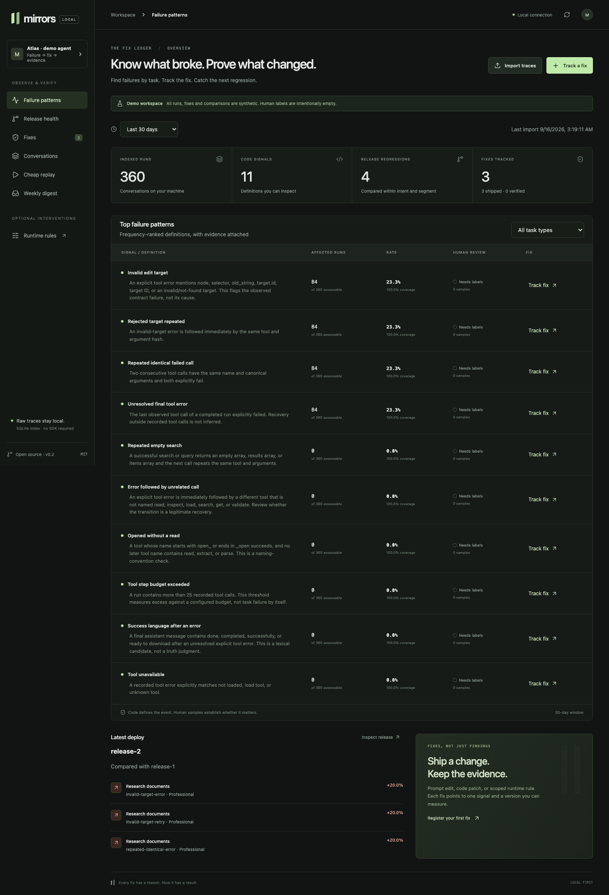

# Mirrors

**Know what broke, by task; track every fix to a number; catch regressions before and after a deploy.**

Mirrors is a local tool for production-agent failure analysis. Import the traces you already have, inspect deterministic failure signals, compare releases within task types and user segments, and link each fix to the outcome it targets.

**The unit is the fix. The primitive is the failure signal. Runtime rules are one optional fix type.**



## Try it

Node.js **22.13+** is required for built-in SQLite. The npm package is not published; install from source:

```sh
git clone https://github.com/ai-singhal/mirrors.git
cd mirrors
npm ci
npm run build
npm link
mirrors demo --dir /tmp/mirrors-demo
mirrors --cwd /tmp/mirrors-demo serve
```

Open **http://127.0.0.1:7433**. The demo has 360 synthetic runs across two versions and three tracked fixes. Human labels are intentionally empty; demonstration metrics are not production evidence.

## Fifteen minutes to your own table

```sh
cd /path/to/your-agent
mirrors init
mirrors ingest ./exported-sessions
mirrors signals list --days 30
mirrors serve
```

No SDK wrapper or inference proxy is required for measurement. JSON/JSONL imports recognize message exports, OTel tool spans, Langfuse-style observations, Braintrust-style rows, Hermes/OpenClaw message sessions, and DocumentDB conversation documents. Vendor-specific formats must contain supported fields; see [ingestion](docs/trace-formats.md).

```sh
# Attach real release tags when the export omitted them.
mirrors ingest ./before --version release-1
mirrors ingest ./after --version release-2
mirrors health --baseline release-1 --version release-2
```

Mirrors does not invent missing deployment versions, model IDs, timestamps, tool schemas, outcomes or human labels.

## Know → fix → verify

1. **Find the failure.** Eleven code signals cover explicit target errors, unchanged failed retries, final errors, completion language, sequence conventions, budgets and missing tools. The top ten are ranked by affected runs.
2. **Align the definition.** Open a conversation and label positive and negative samples. A deterministic match is precise about its definition, not proof that the behavior was wrong.
3. **Register the fix.** Point a prompt edit, code patch or optional runtime rule at one signal and a shipped version.
4. **Check the deploy.** Compare signal rates within intent and segment. Show sample sizes, threshold deltas and worst-run links. Shared deploys remain shared measurements.
5. **Replay the prefix.** Before deploying, run affected conversations against the candidate prompt/model using cached tool results. Stop at the first divergent action; do not manufacture a pass.

```sh
mirrors fix add "Validate the writer's target format" \
  --type code --signal invalid-target-error --source COMMIT_SHA
mirrors fix ship FIX_ID --version release-2 --baseline release-1
mirrors fix results FIX_ID
mirrors fix verify FIX_ID
```

Verification requires enough outcomes, reviewed positive and negative samples, an improvement, and no observed segment regression. It records an observational result, not isolated causal proof.

## Release health without feature flags

Each run carries its version, model, intent and user segment. Default release thresholds are an increase greater than **5 percentage points**, with **30 completed assessable runs per intent/segment/version**. A global traffic-mix change cannot hide behind a single aggregate rate.

```sh
mirrors watch ./exported-sessions --interval 60
```

The watcher polls existing exports and reports changed regressions. With fresh exports and enough samples it can detect a change within the first hour; this is not a latency SLA. For Slack alerts, explicitly add `--webhook-env MIRRORS_SLACK_WEBHOOK`. DocumentDB ingestion uses read-only credentials; scheduled polling can call its CLI command.

## Optional runtime rules

```sh
mirrors fix add "When the same tool call fails twice, inspect the error before retrying" \
  --type rule --signal repeated-identical-error
```

This creates a linked rule in `mirrors.yaml`, starting in shadow. Code conditions evaluate in-process; optional judgments are capped at 300 ms and fail open. Rules can append tail guidance, mask tools, block calls, and use additional supported adapter actions. Only one injection wins per step. Session-hash treatment/control provides optional isolation.

Adapters: AI SDK 7, Hermes, OpenClaw, Pydantic AI, LangGraph, and a legacy OpenAI-compatible proxy. Hook capabilities differ. **Measurement does not depend on any of them.** [Integration guide →](docs/integrations.md)

## Cheap replay, honest limits

```sh
mirrors replay invalid-target-error \
  --model provider/model \
  --prompt ./candidate-system.txt --limit 100
```

Replay explicitly calls the configured model provider. It executes no tools. Cached tool names and argument hashes must match, and cached results must be complete. Results are `completed`, `diverged`, `unreplayable` or `error`; scoring stops at divergence. Missing tool schemas require recorded schemas via `--tools FILE`. A batch deadline and bounded concurrency limit work; they do not guarantee every provider completes 100 runs in ten minutes.

## Local by default

- SQLite in `.mirrors/index.sqlite` indexes runs, steps, signals, labels, versions, fixes, comparisons and replay reports.
- Raw exports and normalized conversations stay in local `.mirrors/runs/` files. Tool arguments are hashed in the SQL index.
- The UI is a single-user loopback service, with Host/Origin validation. No accounts or hosted ingestion.
- No external model request occurs unless you opt into replay, judgment scoring or corrective-model analysis. Webhook delivery is also explicit.
- Keep `.mirrors/`, connection strings and private exports out of git. Only synthetic fixtures and screenshots are included here.

## Docs

- [CLI reference](docs/cli.md)
- [Signal definitions, labels and measurement](docs/measurement.md)
- [Trace import and DocumentDB](docs/trace-formats.md)
- [Runtime integration guide](docs/integrations.md)
- [Optional rule schema](docs/rules.md) · [runtime metrics](docs/runtime-measurement.md)
- [Codex / Claude Code skill](skills/mirrors/SKILL.md)
- [Benchmark methodology](docs/benchmark.md)
- [Release scope and remaining acceptance checks](docs/roadmap.md)

## Develop

```sh
npm ci
npm run check
npx playwright install chromium
npm run test:e2e
npm run bench
python3 -m venv .venv
.venv/bin/pip install -e './python[pydantic,langgraph]'
.venv/bin/python -m unittest discover -s python -p 'test_*.py'
```

Tests exercise actual AI SDK, Pydantic AI TestModel and LangGraph APIs without provider credentials. Hermes/OpenClaw hook tests use contract fixtures. `npm run format:check` checks source and docs. Node 22 may print an experimental SQLite warning.

MIT licensed. Hosted multi-tenant services, stateful world mocking, sandboxes and model training are outside this release.
