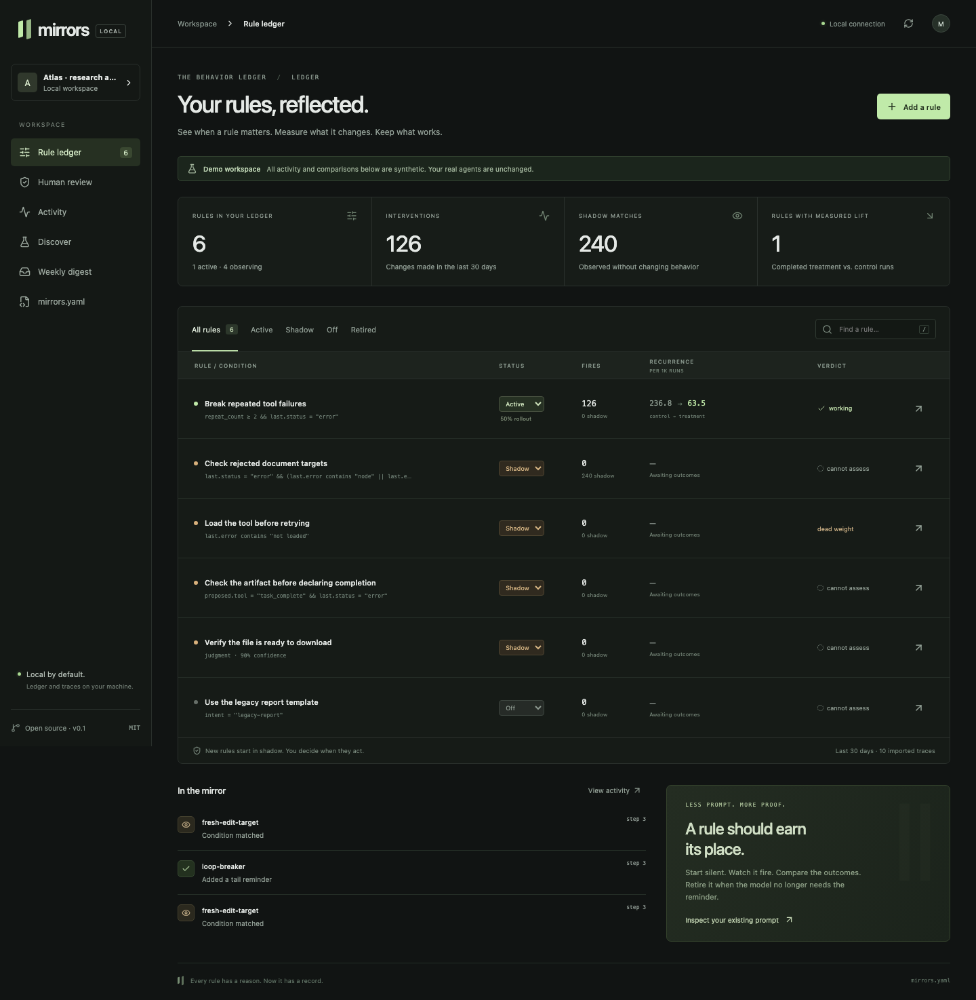

# Mirrors

**Every rule you give your agent gets a condition, a fire count, a recurrence number, and a switch.**

Mirrors is a local behavioral rule ledger for AI agents. Import the instructions already in your prompt, observe them in shadow, and activate only the interventions worth keeping. The ledger lives in your repository as `mirrors.yaml`.



## Try it

Requires Node.js 22 or newer. This is a source release; the npm package has not been published.

```sh
git clone https://github.com/ai-singhal/mirrors.git
cd mirrors
npm ci
npm run build
npm link
mirrors demo --dir /tmp/mirrors-demo
mirrors --cwd /tmp/mirrors-demo serve
```

Open **http://127.0.0.1:7433**. The demo uses clearly labeled synthetic activity. It does not connect to or change an agent.

For your own project:

```sh
cd /path/to/your-agent
mirrors init
mirrors import prompt AGENTS.md
mirrors import traces ./exported-sessions
mirrors backtest --days 30
mirrors serve
```

The four bundled rules and all imported candidates start in **shadow**. Prompt import creates drafts; it does not remove instructions from your prompt. Judgment drafts need an opt-in judge to collect matches.

## The loop

1. **Discover:** import conditional prompt lines, inspect git history, import exported sessions, replay code conditions, or ask the original model for a corrective draft.
2. **Observe:** shadow rules log matching situations without changing the agent.
3. **Intervene:** activate a rule for a deterministic percentage of sessions. Inject a reminder, mask or force a tool, block a call, route a model step, or request human review.
4. **Measure:** label real interventions and compare terminal failure recurrence in treatment and control. Missing evidence stays missing.
5. **Retire:** inspect model-upgrade reports, override thresholds, inactivity and expiry. Lifecycle changes are explicit with `--apply`.

```sh
mirrors add "When the same tool call fails twice, inspect the error before retrying."
mirrors set loop-breaker active --rollout 10
mirrors report
mirrors digest
mirrors lifecycle --apply
```

## A rule is code you can review

```yaml
version: 1
name: My agent
rules:
  - id: loop-breaker
    name: Break repeated tool failures
    status: shadow
    rollout: 10
    priority: 100
    condition:
      type: code
      when:
        all:
          - { field: repeat_count, op: gte, value: 2 }
          - { field: last.status, op: eq, value: error }
    actions:
      - type: inject
        text: Read the error and check the current state before retrying.
    failure:
      class: repeated-tool-error
      when:
        all:
          - { field: repeat_count, op: gte, value: 3 }
          - { field: last.status, op: eq, value: error }
```

Code conditions use a validated predicate language, not arbitrary JavaScript. Rules can also use model judgments with confidence thresholds and timeouts. [Rule reference →](docs/rules.md)

## Connect an agent

| Integration            | Interface                                | Available interventions                                       |
| ---------------------- | ---------------------------------------- | ------------------------------------------------------------- |
| AI SDK 7               | In-process `prepareStep` + tool wrappers | Tail, mask, force, block, human; model swap with resolver     |
| OpenClaw               | Typed plugin hooks                       | Turn-scoped context injection, block, human                   |
| Hermes                 | Python plugin hooks + local server       | Turn-scoped context injection, block, human                   |
| Pydantic AI 2.43+      | Toolset + `ProcessHistory` capability    | Tail, mask, block, human                                      |
| LangGraph 1            | Composable model/tool node helpers       | Tail, mask, force, block, human; host applies model selection |
| OpenAI-compatible HTTP | Local chat-completions proxy             | Tail, mask, force, model selection; streaming passthrough     |
| Other runtimes         | TypeScript engine or loopback JSON API   | All actions; the host applies decisions                       |

Adapters have different hook capabilities. Hermes/OpenClaw context hooks can run once per turn rather than once per model step. The proxy cannot guard external tool execution. **Read the [integration guide](docs/integrations.md) before activation.**

## What the numbers mean

- **Fires** count intervention decisions. Shadow matches are separate.
- **Precision** comes from human labels on fired events; overrides are negatives.
- **Recurrence** uses completed sessions with an explicit failure signal, never a tool error count divided by tool calls.
- **Treatment/control** assignment is stable for a rule and session. At 100% rollout there is no control comparison.
- **Backtests** find historical situations. They do not establish that an unexecuted intervention would have fixed them.
- **Prompt savings** are differences between explicitly recorded prompt snapshots, estimated as characters / 4. They are not provider billing measurements.
- **Latency** in the ledger is engine evaluation time. It excludes persistence and HTTP overhead.

The demo's lift is invented demonstration data. No production-effectiveness claim is made. See [measurement methodology](docs/measurement.md) and the reproducible [microbenchmark](docs/benchmark.md).

## Local by default

`mirrors.yaml` is the source of truth; commit it and revert changes through git. Private runtime records and imported traces live in `.mirrors/` and should stay out of version control. The UI binds to loopback with local Host/Origin checks. It has no accounts or remote access configuration.

No telemetry leaves the machine by default. `serve --judge`, `proxy --judge`, `ask-agent`, and explicit webhook delivery can send data externally. Keys come from environment variables. Mirrors is **fail-open behavioral guidance**, not an authorization or security boundary.

## Commands and tools

- [CLI reference](docs/cli.md)
- [Rule schema and runtime semantics](docs/rules.md)
- [Framework integrations and HTTP API](docs/integrations.md)
- [Trace formats](docs/trace-formats.md)
- [Measurement and lifecycle](docs/measurement.md)
- [Codex / Claude Code skill](skills/mirrors/SKILL.md)
- [Runnable examples](examples/)
- [Release scope and roadmap](docs/roadmap.md)

## Develop

```sh
npm ci
npm run check
npx playwright install chromium
npm run test:e2e
npm run bench
python3 -m venv .venv
.venv/bin/pip install -e './python[pydantic,langgraph]'
.venv/bin/python -m unittest discover -s python -p 'test_*.py'
```

Tests use local fixtures and mock models, with no provider credentials. `npm run format:check` checks TypeScript, UI and documentation formatting. Contributions should include evidence for changed behavior and start new packs in shadow.

MIT licensed. Mirrors Cloud, a hosted registry, team roles, and cross-customer metrics are future work.
